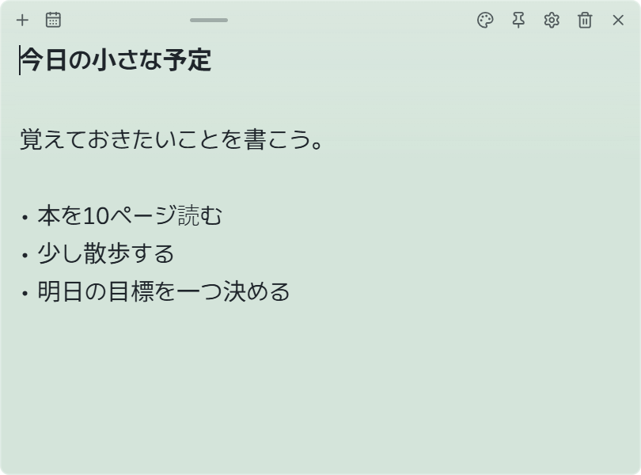

# Pinboard

[한국어](README.md) | [English](README.en.md) | [简体中文](README.zh.md) | **日本語** | [Français](README.fr.md) | [Español](README.es.md)

**デスクトップに貼って、思いついたときにすぐ書ける付箋メモ。**

今日の予定、買い物リスト、ひらめきを、目に入る場所に置いておきましょう。
無料で使えます。基本のメモ機能には、アカウント登録も AI への接続も必要ありません。

## ダウンロード

**[Windows 版をダウンロード · v0.1.0](https://github.com/CookiePiano/Pinboard/releases/download/v0.1.0/Pinboard_0.1.0_x64-setup.exe)**

Windows 11 x64 に対応しています。
インストールせずに使う場合は [ポータブル版 ZIP](https://github.com/CookiePiano/Pinboard/releases/download/v0.1.0/Pinboard_0.1.0_windows-x64-portable.zip) をダウンロードしてください。

> 初回リリースは署名されていないため、Windows に発行元不明の警告が表示される場合があります。
> [公式リリース](https://github.com/CookiePiano/Pinboard/releases/tag/v0.1.0) と [ダウンロード時の確認事項](docs/user-guide.ja.md#download-safety) を確認し、Windows のセキュリティ保護は有効にしておいてください。

## 3 ステップで始める

1. 上の **Windows 版をダウンロード** からインストーラーを入手し、インストールします。
2. **Pinboard** を開いて、メモに入力します。内容は自動保存されます。
3. メモ上部の **＋** をクリックすると、新しいメモを作れます。

**[画像で見る使い方ガイド →](docs/user-guide.ja.md)**

ガイドの言語：[한국어](docs/user-guide.md) · [English](docs/user-guide.en.md) · [简体中文](docs/user-guide.zh.md) · [日本語](docs/user-guide.ja.md) · [Français](docs/user-guide.fr.md) · [Español](docs/user-guide.es.md)

## こんな使い方ができます

- **すぐに書く** — やることや思いつきをメモして、好きな場所へ移動。
- **好みの見た目にする** — 色、透明度、文字サイズを選べます。
- **見える場所に置く** — ほかのウィンドウより手前や、デスクトップに固定。
- **あとから探す** — カレンダーで作成日を選んでメモを開けます。

## よくある質問

**メモを閉じると消えますか？**

メモの **×** は非表示にするボタンです。タスクバーの通知領域にある Pinboard を右クリックし、**すべてのメモを表示** を選ぶと再表示できます。

**日本語に切り替えるには？**

メモの歯車をクリックし、**일반 → 언어 (Language Setting) → 日本語** を選びます。

**メモをバックアップできますか？**

**設定 → 同期 → エクスポート** で、メモと設定を ZIP ファイルに保存できます。

---

[使い方ガイド](docs/user-guide.ja.md) · [問題を報告](https://github.com/CookiePiano/Pinboard/issues) · [開発者向け文書（英語）](docs/technical-reference.md)

[プライバシー（英語）](docs/privacy.md) · [セキュリティ（英語）](SECURITY.md) · [MIT ライセンス](LICENSE) · [第三者に関する通知](THIRD-PARTY-NOTICES.txt)

以前の詳しい説明をお探しですか？

動作の詳細、データの保存、ビルド方法は [技術リファレンス（英語）](docs/technical-reference.md) にあります。

