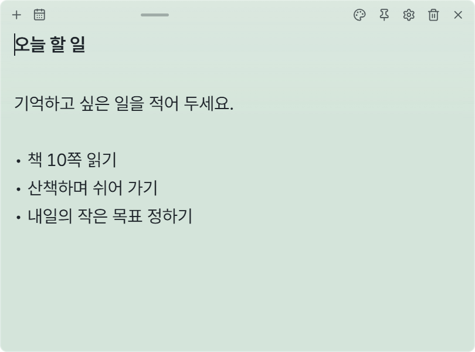

# Pinboard

**한국어** | [English](README.en.md)

**바탕화면에 붙여 두고, 생각날 때 바로 적는 스티커 메모 앱.**

오늘 할 일, 장보기 목록, 떠오른 아이디어를 눈에 잘 보이는 곳에 두세요.
무료로 사용할 수 있으며, 기본 메모 기능에는 회원가입이나 AI 연결이 필요하지 않습니다.

## 다운로드

**[Windows용 다운로드 · v0.1.0](https://github.com/CookiePiano/Pinboard/releases/download/v0.1.0/Pinboard_0.1.0_x64-setup.exe)**

Windows 11 x64에서 사용할 수 있습니다.
설치 없이 쓰려면 [포터블 ZIP](https://github.com/CookiePiano/Pinboard/releases/download/v0.1.0/Pinboard_0.1.0_windows-x64-portable.zip)을 받으세요.

> 첫 버전은 코드 서명이 없어 Windows에서 게시자 확인 경고가 나올 수 있습니다.
> [공식 릴리스](https://github.com/CookiePiano/Pinboard/releases/tag/v0.1.0)와 [다운로드 확인 방법](docs/user-guide.md#download-safety)을 확인하세요. Windows 보안 기능은 끄지 마세요.

## 세 단계로 시작하기

1. 위의 **Windows용 다운로드**로 설치 파일을 받고 설치합니다.
2. **Pinboard**를 실행하고 메모에 글을 적습니다. 내용은 자동으로 저장됩니다.
3. 메모 위쪽의 **＋**를 누르면 새 메모를 만들 수 있습니다.

**[그림으로 보는 사용 가이드 →](docs/user-guide.md)**

## 이렇게 써 보세요

- **바로 적기** — 할 일이나 생각을 메모하고, 원하는 곳으로 옮겨 두세요.
- **내 취향으로 꾸미기** — 메모 색상과 투명도, 글자 크기를 바꿔 보세요.
- **눈에 잘 보이게 고정하기** — 다른 창 위에 두거나 바탕화면에 붙여 두세요.
- **달력에서 다시 찾기** — 작성한 날짜를 눌러 메모를 열어 보세요.

## 자주 궁금한 점

**메모를 닫으면 지워지나요?**

메모의 **×**는 숨기기입니다. 작업 표시줄 오른쪽 알림 영역의 Pinboard 아이콘을 오른쪽 클릭한 뒤 **모든 메모 보이기**를 선택하면 다시 나타납니다.

**영어로 사용할 수 있나요?**

메모의 톱니바퀴 → **일반 → 언어 (Language Setting)** 항목에서 **English**를 선택하세요.

**메모를 백업할 수 있나요?**

**설정 → 동기화 → 내보내기**를 누르면 메모와 설정을 ZIP 파일로 보관할 수 있습니다.

---

[사용 가이드](docs/user-guide.md) · [문제 알리기](https://github.com/CookiePiano/Pinboard/issues) · [개발 문서](docs/technical-reference.md)

[개인정보 안내 · English](docs/privacy.md) · [보안 정책 · English](SECURITY.md) · [MIT 라이선스](LICENSE) · [타사 고지](THIRD-PARTY-NOTICES.txt)

기존 상세 설명을 찾고 계신가요?

기능의 자세한 동작, 데이터 저장, 빌드 방법은 [기술 참고 문서](docs/technical-reference.md)에 있습니다.

