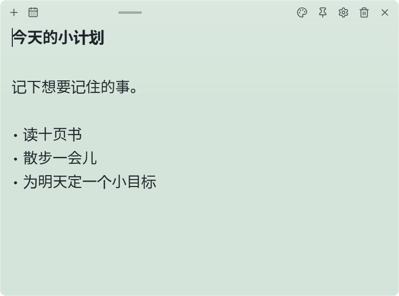

# Pinboard

[한국어](README.md) | [English](README.en.md) | **简体中文** | [日本語](README.ja.md) | [Français](README.fr.md) | [Español](README.es.md)

**贴在桌面上的便签，想起什么就随手记下。**

把今天的计划、购物清单和灵感放在一眼就能看到的地方。
Pinboard 可以免费使用，基本记事功能不需要注册账号或连接 AI。

## 下载

**[下载 Windows 版 · v0.1.0](https://github.com/CookiePiano/Pinboard/releases/download/v0.1.0/Pinboard_0.1.0_x64-setup.exe)**

适用于 Windows 11 x64。
如果不想安装，可以下载 [便携版 ZIP](https://github.com/CookiePiano/Pinboard/releases/download/v0.1.0/Pinboard_0.1.0_windows-x64-portable.zip)。

> 首个版本尚未签名，Windows 可能显示发布者未知的提示。
> 请查看 [官方发布页面](https://github.com/CookiePiano/Pinboard/releases/tag/v0.1.0) 和 [下载说明](docs/user-guide.zh.md#download-safety)。请保持 Windows 安全防护开启。

## 三步开始使用

1. 点击上面的 **下载 Windows 版**，下载安装程序并完成安装。
2. 打开 **Pinboard**，在便签中输入文字。内容会自动保存。
3. 点击便签顶部的 **＋**，即可新建便签。

**[查看图文使用指南 →](docs/user-guide.zh.md)**

指南语言：[한국어](docs/user-guide.md) · [English](docs/user-guide.en.md) · [简体中文](docs/user-guide.zh.md) · [日本語](docs/user-guide.ja.md) · [Français](docs/user-guide.fr.md) · [Español](docs/user-guide.es.md)

## 试着这样用

- **随手记下** — 记录待办事项和想法，把便签移到合适的位置。
- **调整外观** — 选择喜欢的颜色、透明度和字号。
- **放在显眼的位置** — 将便签置顶，或留在桌面上。
- **重新找到便签** — 在日历中选择创建日期，打开当天的便签。

## 常见问题

**关闭便签会删除内容吗？**

便签上的 **×** 只是隐藏。右键点击任务栏通知区域的 Pinboard 图标，选择 **显示所有便签** 即可重新显示。

**如何切换到简体中文？**

点击便签上的齿轮，再选择 **일반 → 언어 (Language Setting) → 简体中文**。

**可以备份便签吗？**

打开 **设置 → 同步 → 导出**，即可将便签和设置保存为 ZIP 文件。

---

[使用指南](docs/user-guide.zh.md) · [报告问题](https://github.com/CookiePiano/Pinboard/issues) · [开发文档（英文）](docs/technical-reference.md)

[隐私说明（英文）](docs/privacy.md) · [安全政策（英文）](SECURITY.md) · [MIT 许可证](LICENSE) · [第三方声明](THIRD-PARTY-NOTICES.txt)

在找之前的详细说明？

功能的详细行为、数据存储和构建方法见 [技术参考文档（英文）](docs/technical-reference.md)。

