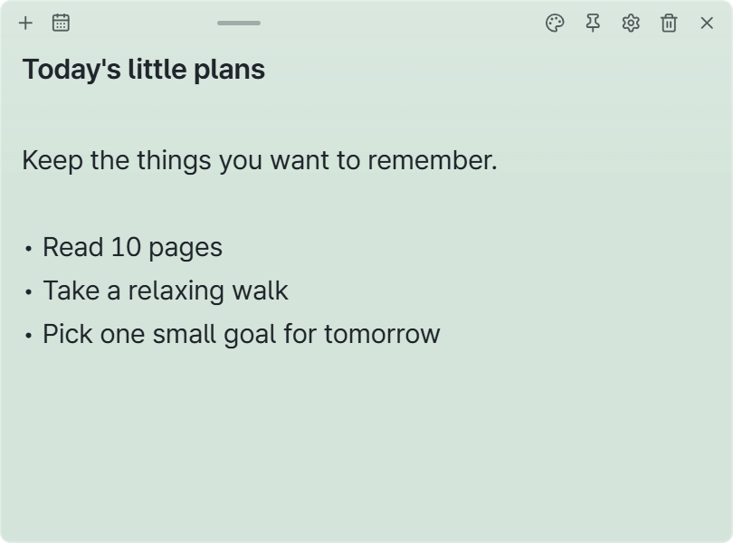
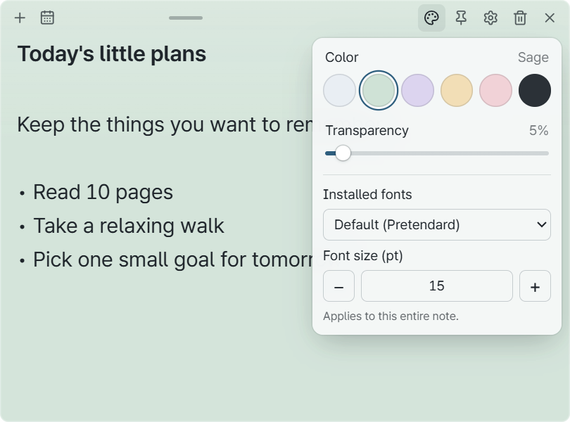
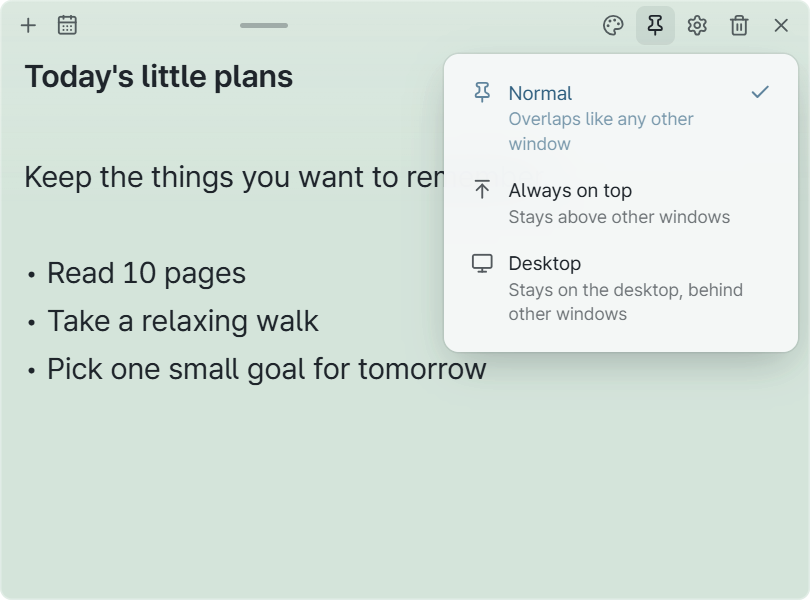
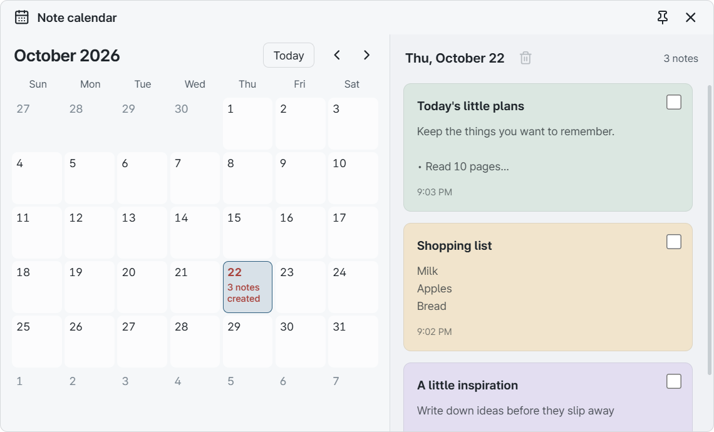
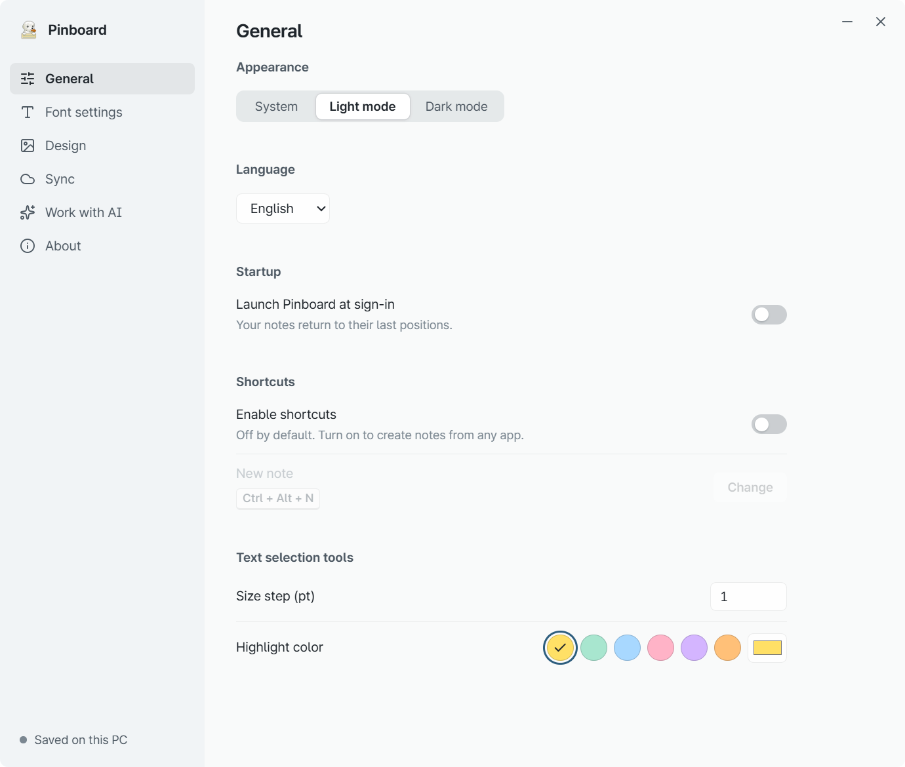
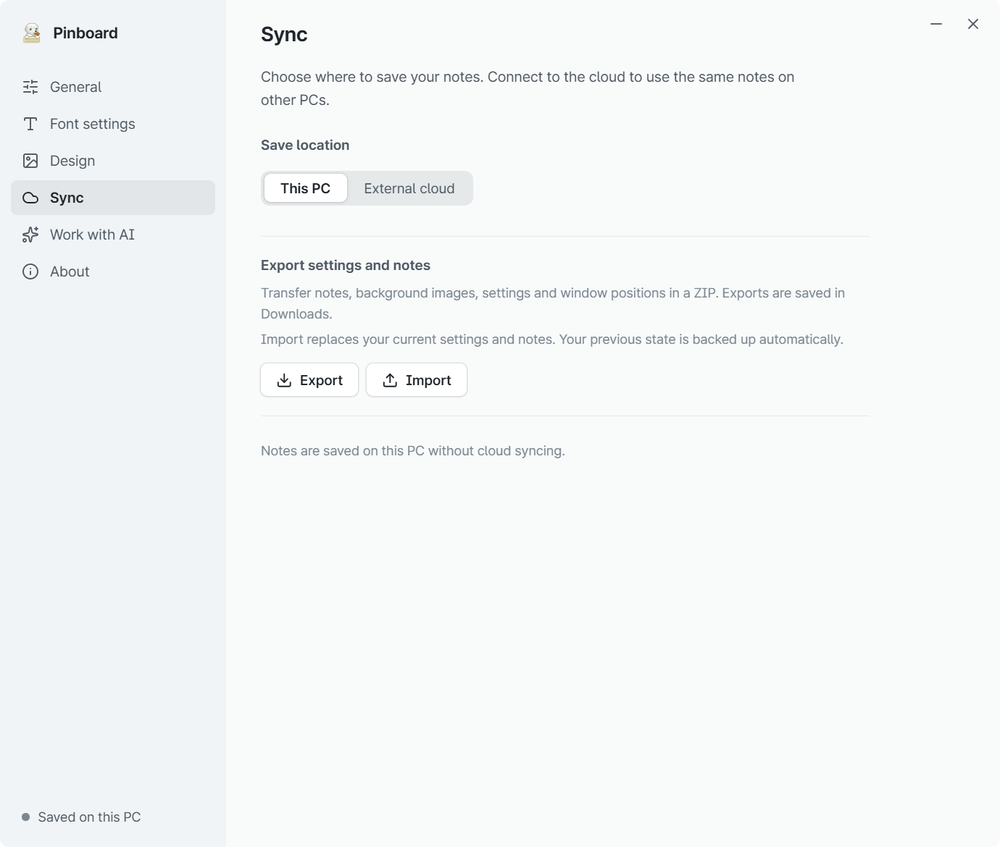

# Pinboard user guide

[한국어](user-guide.md) | **English** · [Back to the introduction](../README.en.md)

Start by writing a note. You can explore colors and settings whenever you need them.
This guide covers v0.1.0 for Windows 11. All screenshots use made-up example notes.
If text in a screenshot looks small, click the image to view it at full size.

[Install](#install) · [Write notes](#notes) · [Customize](#appearance) · [Pin](#pin) · [Hide or delete](#hide-delete) · [Calendar](#calendar) · [Settings](#settings) · [Back up](#backup)

## 1. Install and open Pinboard

1. Get the [Windows installer](https://github.com/CookiePiano/Pinboard/releases/download/v0.1.0/Pinboard_0.1.0_x64-setup.exe). You need **Windows 11 x64**.
2. Run the installer and follow its instructions.
3. Open **Pinboard** from the Windows Start menu and type in the note that appears.

No account or AI connection is required. Notes stay on this PC by default.
The app starts in Korean. To switch, click the gear on a note, then **일반 (General) → 언어 (Language Setting) → English**. The screenshots below show the English interface.

**To use it without installing:** download the [portable ZIP](https://github.com/CookiePiano/Pinboard/releases/download/v0.1.0/Pinboard_0.1.0_windows-x64-portable.zip), extract it, then run `Pinboard.exe`. Do not run it from inside the ZIP.
The portable edition also stores notes in this PC's app data folder, not next to the executable. Use [backup and export](#backup) to take notes to another PC.

### If Windows shows a publisher warning

The first release, 0.1.0, is unsigned, so Windows may show an unknown-publisher warning.
Check that the file came from the [official release page](https://github.com/CookiePiano/Pinboard/releases/tag/v0.1.0) and matches the filename linked above.
These checks alone do not guarantee safety. Do not run a file if you are unsure of its source.
Keep Windows security protections on. See the [file verification guide](download-verification.md) for further checks.

## 2. Make a note and start writing

1. Click **＋ — New note** at the top of a note.
2. Click inside and type. The first line appears as a title.
3. Your changes save automatically. There is no Save button to press.

Drag the handle in the middle of the top bar to move a note. Drag an edge to resize it.
If a save error appears, keep the note open and resolve the storage or folder-access problem first.

## 3. Change colors and text

1. Click the **palette — Color and transparency** button at the top of a note.
2. Pick a color and adjust **Transparency**.
3. Choose **Installed fonts** and **Font size (pt)** below. These changes apply to this note.

To emphasize just a few words, select them by dragging. The **B / I / − / + / H** tools apply bold, italic, size and highlighting.
To add a background image, open **gear → Design**.

## 4. Choose where a note stays

Click the **pin — Position** button at the top of a note and choose a mode.

| Mode | Use it when you want to… |
| --- | --- |
| **Normal** | Use the note like any other app window |
| **Always on top** | Keep the note visible while working in other apps |
| **Desktop** | Leave the note on your desktop, behind other windows |

The button's icon changes with the selected mode. Use the same button to change it again.

## 5. Hide a note or delete it

- **Hide for now:** click **× — Hide** on a note. Its content is kept.
- **Bring notes back:** right-click the **Pinboard icon in the taskbar notification area → Show all notes**. Expand the hidden icons if you cannot see it.
- **Delete:** click the **trash — Delete note** button, then click the confirmation button once more. This deletes the note. If cloud sync is enabled, deletion also reaches your other PCs.
- **Quit the app:** choose **Quit Pinboard** from the same notification-area menu.

Pinboard keeps running in the notification area even when all notes are hidden.

## 6. Find a note in the calendar

1. Click the **calendar — Note calendar** button at the top of a note.
2. Choose the date you created the note. Dates with notes show a count.
3. Click a note card in the list on the right to open that note.

The calendar finds notes by their **creation date**. It does not set reminders or due dates.

## 7. Choose a language and startup options

Open **gear → General** from a note.

- **Language:** choose English, Korean or another supported language. This changes the interface, not the text you wrote.
- **Appearance:** choose System, Light mode or Dark mode.
- **Launch Pinboard at sign-in:** turn this on if you want the app to start with your Windows session.
- **Enable shortcuts:** turn this on, click **Change**, then press your preferred combination to create a note from another app. Include Ctrl, Alt or the Windows key.

Login startup and global shortcuts are off initially. A shortcut may be unavailable if another app already uses it.

## 8. Back up or move your notes

**To make a backup**

1. Open **gear → Sync** from a note.
2. Under **Export settings and notes**, click **Export**.
3. Keep the resulting `Pinboard_date_time.zip` file from Downloads somewhere safe.

**To bring notes back**

1. Open Pinboard on the destination PC and go to **gear → Sync**.
2. Click **Import** and choose a ZIP you previously exported.

**Import replaces your current notes and settings.** The previous state is backed up automatically first, but it is a good idea to export anything important yourself.
The backup includes notes, background images, formatting, settings and window positions. A ZIP may contain private notes, so do not attach it to a public issue.

## Optional extras

- **Sync with another PC:** connect a folder managed by Google Drive for Desktop. [Connection guide](google-drive-setup.md)
- **Work with AI:** explicitly connect an AI app and allow access. A connected AI can read, change and delete notes. [Connection guide](ai-collaboration.md)

Neither feature is needed for everyday notes. Notes and backups are not encrypted; do not use them to store sensitive information such as passwords.

## Need a hand?

[Report an issue](https://github.com/CookiePiano/Pinboard/issues) with the app version and the steps that led to the problem.
Before attaching a screenshot, check that it does not show private notes, names, email addresses, account details or folder paths.
For security problems, use the private reporting instructions in the [security policy](../SECURITY.md).

[Back to the introduction](../README.en.md) · [한국어 가이드](user-guide.md)
