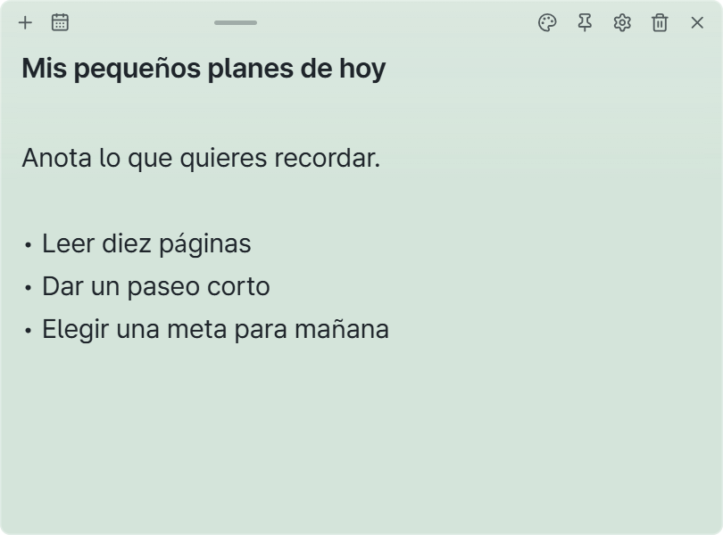
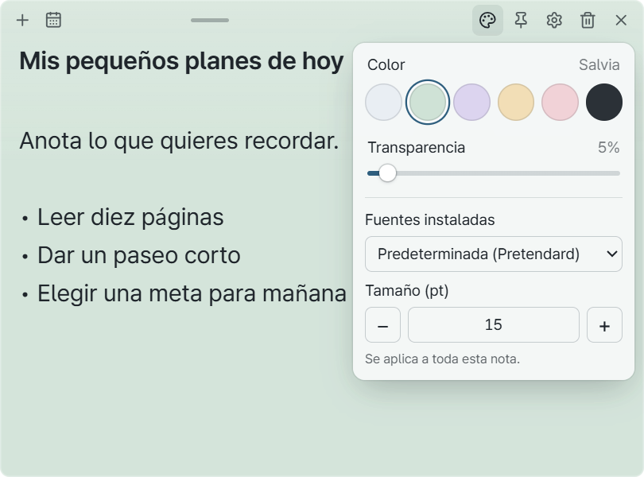
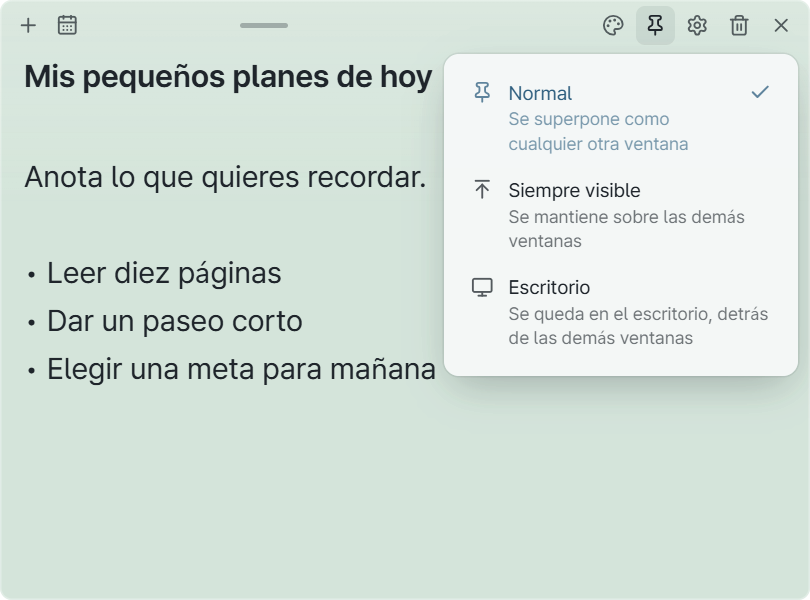
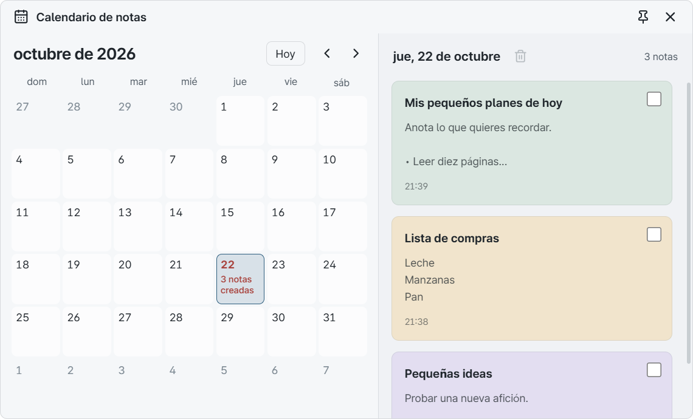
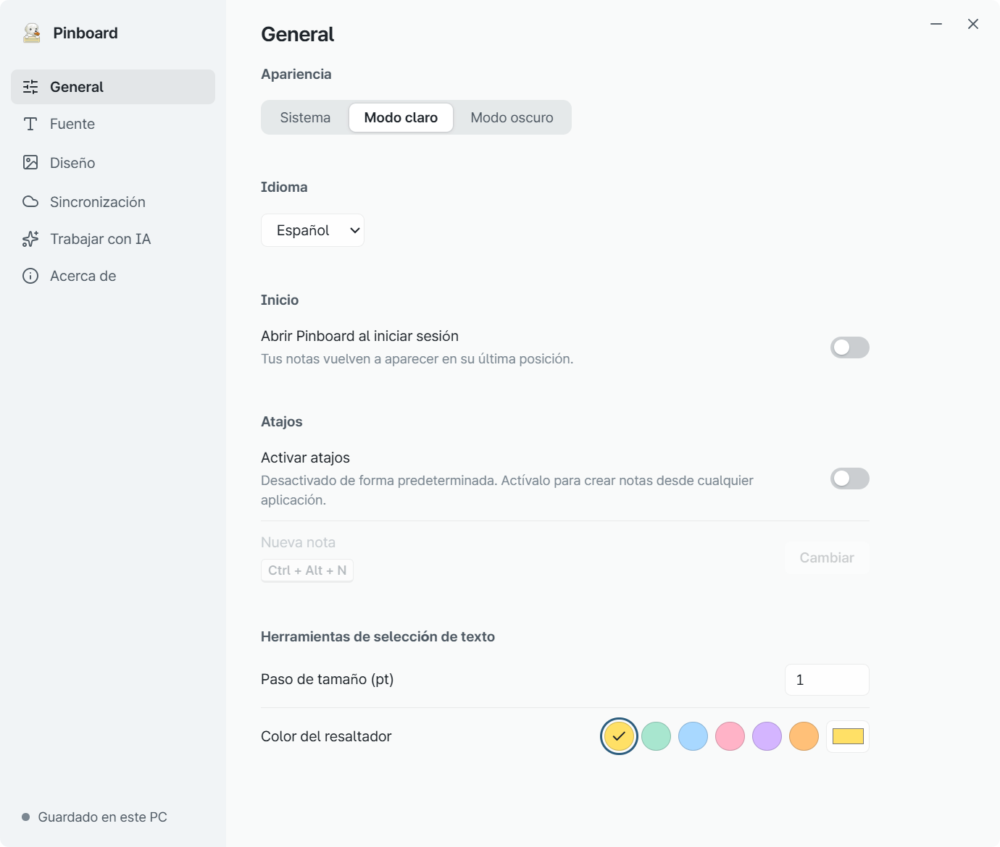
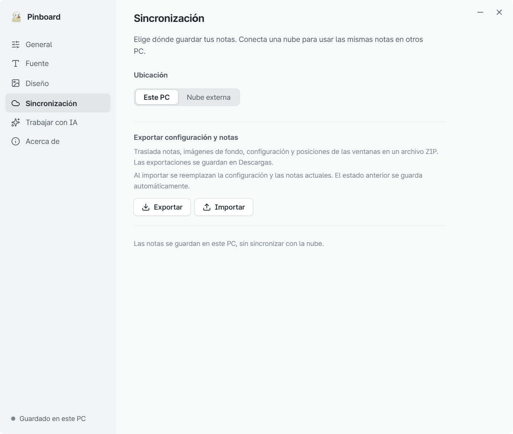

# Guía de uso de Pinboard

[한국어](user-guide.md) | [English](user-guide.en.md) | [简体中文](user-guide.zh.md) | [日本語](user-guide.ja.md) | [Français](user-guide.fr.md) | **Español**

[Volver a la presentación](../README.es.md)

Empieza escribiendo una nota. Puedes elegir colores y cambiar la configuración cuando lo necesites.
Esta guía corresponde a la versión 0.1.0 para Windows 11. Todas las notas de las imágenes son ejemplos ficticios.
Si el texto de una captura se ve pequeño, haz clic en la imagen para verla a tamaño completo.

[Instalar](#install) · [Escribir](#notes) · [Personalizar](#appearance) · [Fijar](#pin) · [Ocultar o eliminar](#hide-delete) · [Calendario](#calendar) · [Configuración](#settings) · [Copia de seguridad](#backup)

## 1. Instala y abre Pinboard

1. Descarga el [instalador de Windows](https://github.com/CookiePiano/Pinboard/releases/download/v0.1.0/Pinboard_0.1.0_x64-setup.exe). Necesitas **Windows 11 x64**.
2. Ejecuta el instalador y sigue las instrucciones.
3. Abre **Pinboard** desde el menú Inicio y escribe en la nota que aparece.

No necesitas una cuenta ni una conexión con IA. Las notas se guardan en este PC de forma predeterminada.
La aplicación se inicia en coreano. Para cambiar el idioma, pulsa el engranaje de una nota y selecciona **일반 → 언어 (Language Setting) → Español**. Las imágenes de abajo muestran la interfaz en español.

**Para usarla sin instalar:** descarga el [ZIP portátil](https://github.com/CookiePiano/Pinboard/releases/download/v0.1.0/Pinboard_0.1.0_windows-x64-portable.zip), descomprímelo y ejecuta `Pinboard.exe`. No lo ejecutes desde dentro del ZIP.
La edición portátil también guarda las notas en la carpeta de datos de la aplicación de este PC, no junto al ejecutable. Usa la [copia de seguridad y exportación](#backup) para llevarlas a otro PC.

### Si Windows muestra una advertencia sobre el editor

La primera versión, 0.1.0, no está firmada, por lo que Windows puede mostrar un aviso de editor desconocido.
Comprueba que el archivo procede de la [página oficial de la versión](https://github.com/CookiePiano/Pinboard/releases/tag/v0.1.0) y que su nombre coincide con el enlace de arriba.
Estas comprobaciones por sí solas no garantizan su seguridad. No ejecutes un archivo si no conoces su procedencia.
Mantén activadas las protecciones de Windows. Consulta la [guía de verificación de archivos, en inglés](download-verification.md), para realizar otras comprobaciones.

## 2. Crea una nota y empieza a escribir

1. Pulsa **＋ — Nueva nota** en la parte superior de una nota.
2. Haz clic dentro y escribe. La primera línea se muestra como título.
3. Los cambios se guardan automáticamente. No hay que pulsar un botón Guardar.

Arrastra el tirador del centro de la barra superior para mover la nota. Arrastra un borde para cambiar su tamaño.
Si aparece un error al guardar, deja la nota abierta y resuelve primero el problema de almacenamiento o de acceso a la carpeta.

## 3. Cambia los colores y el texto

1. Pulsa **paleta — Color y transparencia** en la parte superior de la nota.
2. Elige un color y ajusta la **Transparencia**.
3. Debajo, elige **Fuentes instaladas** y **Tamaño (pt)**. Estos cambios se aplican a esta nota.

Para destacar unas palabras, selecciónalas arrastrando el ratón. Las herramientas **B / I / − / + / H** permiten aplicar negrita, cursiva, tamaño y resaltado.
Para añadir una imagen de fondo, abre **engranaje → Diseño**.

## 4. Elige dónde se muestra la nota

Pulsa **chincheta — Posición** en la parte superior de la nota y elige un modo.

| Modo | Para… |
| --- | --- |
| **Normal** | Usar la nota como cualquier otra ventana |
| **Siempre visible** | Ver la nota mientras trabajas en otras aplicaciones |
| **Escritorio** | Dejar la nota en el escritorio, detrás de las demás ventanas |

El icono cambia según el modo seleccionado. Usa el mismo botón para cambiarlo de nuevo.

## 5. Oculta o elimina una nota

- **Ocultar por ahora:** pulsa **× — Ocultar** en la nota. El contenido se conserva.
- **Volver a ver las notas:** haz clic derecho en **el icono de Pinboard del área de notificación de la barra de tareas → Mostrar todas las notas**. Despliega los iconos ocultos si no lo encuentras.
- **Eliminar:** pulsa **papelera — Eliminar nota** y vuelve a pulsar el botón de confirmación. Si la sincronización en la nube está activada, la eliminación también llega a los demás PC.
- **Cerrar la aplicación:** selecciona **Salir de Pinboard** en el mismo menú del área de notificación.

Pinboard sigue funcionando en el área de notificación aunque todas las notas estén ocultas.

## 6. Busca una nota en el calendario

1. Pulsa **calendario — Calendario de notas** en la parte superior de una nota.
2. Elige la fecha en la que creaste la nota. Los días con notas muestran su cantidad.
3. Pulsa una tarjeta de la lista de la derecha para abrir la nota.

El calendario busca notas por su **fecha de creación**. No sirve para programar recordatorios ni fechas límite.

## 7. Elige el idioma y las opciones de inicio

Desde una nota, abre **engranaje → General**.

- **Idioma:** elige español u otro idioma disponible. Cambia la interfaz, pero no traduce lo que has escrito.
- **Apariencia:** elige Sistema, Modo claro o Modo oscuro.
- **Abrir Pinboard al iniciar sesión:** activa esta opción si quieres que la aplicación se abra con Windows.
- **Activar atajos:** activa la opción, pulsa **Cambiar** y presiona la combinación que prefieras para crear notas desde otra aplicación. Incluye Ctrl, Alt o la tecla Windows.

El inicio automático y los atajos globales están desactivados al principio. Una combinación puede no estar disponible si otra aplicación ya la usa.

> **Problema conocido de la v0.1.0:** el botón X de la configuración no cierra la ventana. Por ahora, minimízala o elige **Salir de Pinboard** en el área de notificación y vuelve a abrir la aplicación. La corrección del código no actualiza automáticamente el instalador v0.1.0 existente.

## 8. Haz una copia o traslada tus notas

**Crear una copia de seguridad**

1. Desde una nota, abre **engranaje → Sincronización**.
2. En **Exportar configuración y notas**, pulsa **Exportar**.
3. Guarda en un lugar seguro el archivo `Pinboard_date_time.zip` que se crea en Descargas.

**Recuperar las notas**

1. Abre Pinboard en el PC de destino y entra en **engranaje → Sincronización**.
2. Pulsa **Importar** y elige un ZIP que hayas exportado antes.

**La importación sustituye las notas y la configuración actuales.** Primero se hace una copia automática del estado anterior, pero conviene exportar también por tu cuenta lo que sea importante.
La copia incluye notas, imágenes de fondo, formato, configuración y posiciones de las ventanas. El ZIP puede contener información privada: no lo adjuntes a un informe público.

## Funciones opcionales

- **Sincronizar con otro PC:** conecta una carpeta gestionada por Google Drive for Desktop. [Guía de conexión en inglés](google-drive-setup.md)
- **Trabajar con IA:** conecta expresamente una aplicación de IA y permite el acceso. La IA conectada puede leer, modificar y eliminar notas. [Guía de conexión en inglés](ai-collaboration.md)

No necesitas estas funciones para las notas del día a día. Las notas y las copias no están cifradas; no guardes contraseñas ni otros datos sensibles en ellas.

## ¿Necesitas ayuda?

[Informa de un problema](https://github.com/CookiePiano/Pinboard/issues) e indica la versión de la aplicación y los pasos para reproducirlo.
Antes de adjuntar una captura, comprueba que no muestre notas privadas, nombres, correos electrónicos, datos de cuentas ni rutas de carpetas.
Para problemas de seguridad, sigue las instrucciones de comunicación privada de la [política de seguridad, en inglés](../SECURITY.md).

[Volver a la presentación](../README.es.md)
