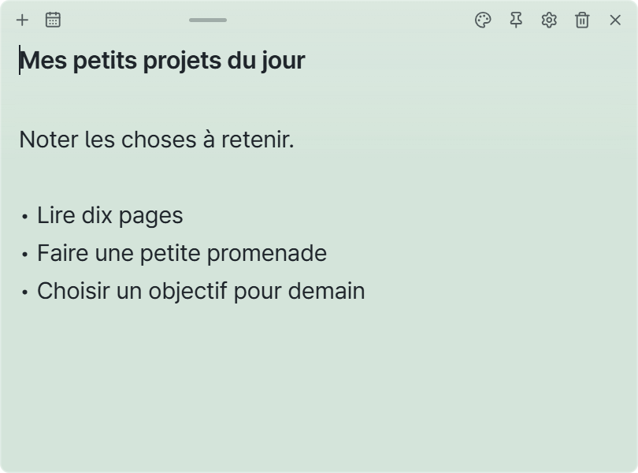
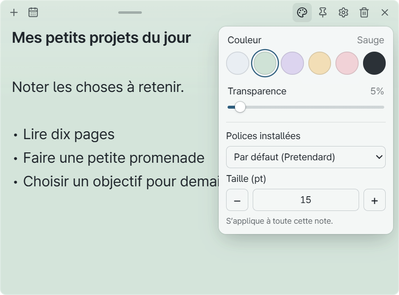
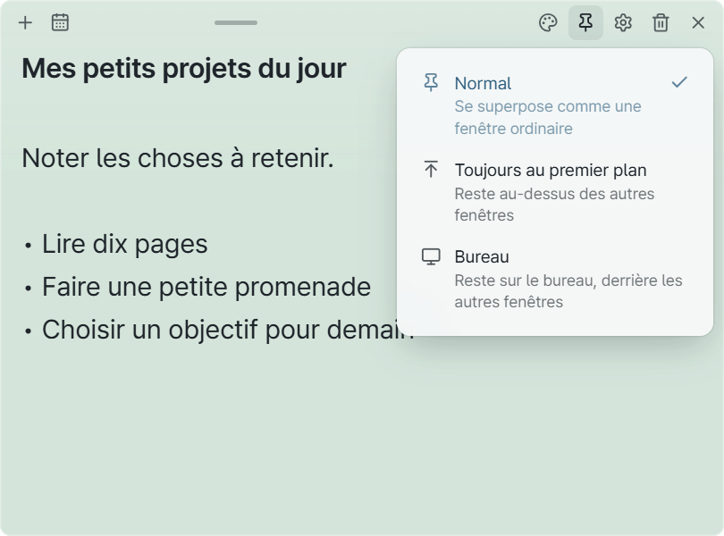
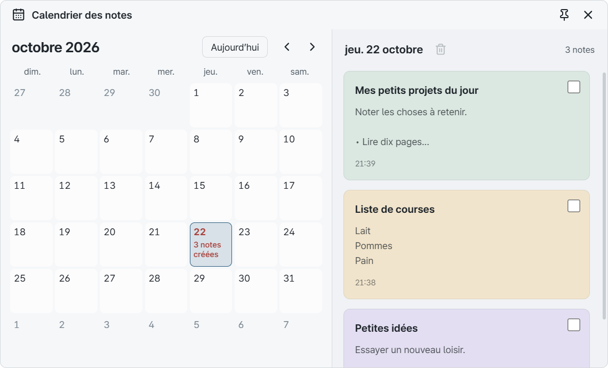
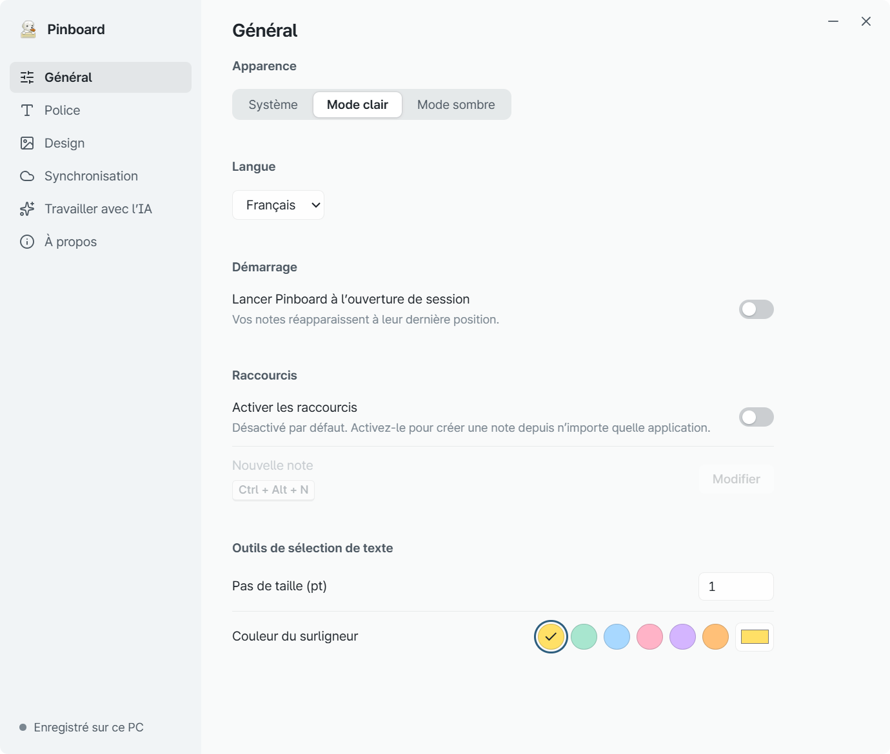
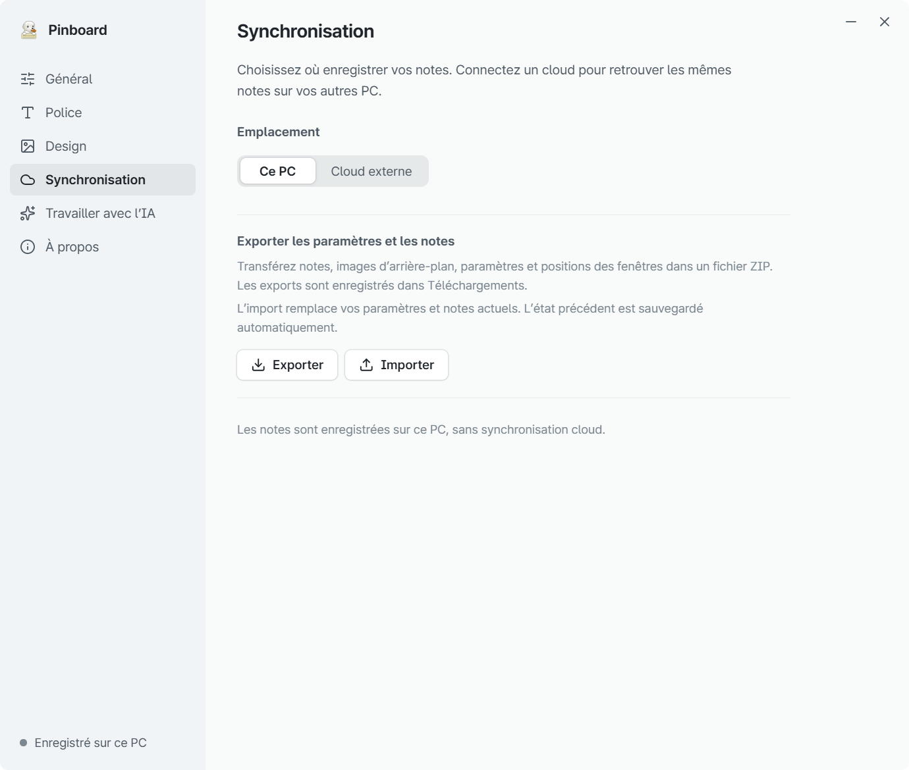

# Guide d’utilisation de Pinboard

[한국어](user-guide.md) | [English](user-guide.en.md) | [简体中文](user-guide.zh.md) | [日本語](user-guide.ja.md) | **Français** | [Español](user-guide.es.md)

[Retour à la présentation](../README.fr.md)

Commencez par écrire une note. Vous pourrez choisir les couleurs et les réglages plus tard.
Ce guide concerne la version 0.1.0 pour Windows 11. Toutes les notes des captures sont des exemples fictifs.
Cliquez sur une image pour l’afficher en taille réelle si le texte est trop petit.

[Installer](#install) · [Écrire](#notes) · [Personnaliser](#appearance) · [Positionner](#pin) · [Masquer ou supprimer](#hide-delete) · [Calendrier](#calendar) · [Paramètres](#settings) · [Sauvegarder](#backup)

## 1. Installer et ouvrir Pinboard

1. Téléchargez le [programme d’installation Windows](https://github.com/CookiePiano/Pinboard/releases/download/v0.1.0-r2/Pinboard_0.1.0_x64-setup.exe). Il faut **Windows 11 x64**.
2. Lancez le programme et suivez les instructions.
3. Ouvrez **Pinboard** depuis le menu Démarrer et écrivez dans la note qui apparaît.

Aucun compte ni connexion à une IA n’est nécessaire. Par défaut, les notes restent sur ce PC.
L’application démarre en coréen. Pour passer en français, cliquez sur la roue dentée d’une note, puis choisissez **일반 → 언어 (Language Setting) → Français**. Les captures ci-dessous montrent l’interface française.

**Sans installation :** téléchargez le [ZIP portable](https://github.com/CookiePiano/Pinboard/releases/download/v0.1.0-r2/Pinboard_0.1.0_windows-x64-portable.zip), décompressez-le, puis lancez `Pinboard.exe`. Ne le lancez pas directement depuis le ZIP.
La version portable conserve aussi les notes dans le dossier de données de l’application sur ce PC, et non à côté de l’exécutable. Pour changer de PC, utilisez la [sauvegarde et l’exportation](#backup).

### Si Windows affiche un avertissement sur l’éditeur

La première version, 0.1.0, n’est pas signée. Windows peut donc indiquer que l’éditeur est inconnu.
Vérifiez que le fichier provient de la [page officielle de la version](https://github.com/CookiePiano/Pinboard/releases/tag/v0.1.0-r2) et que son nom correspond au lien ci-dessus.
Ces vérifications seules ne garantissent pas sa sécurité. Ne lancez pas un fichier dont vous ne connaissez pas la provenance.
Gardez les protections de Windows activées. Le [guide de vérification des fichiers, en anglais](download-verification.md), explique les autres contrôles possibles.

## 2. Créer une note et écrire

1. Cliquez sur **＋ — Nouvelle note** en haut d’une note.
2. Cliquez à l’intérieur et écrivez. La première ligne sert de titre.
3. Les modifications sont enregistrées automatiquement, sans bouton Enregistrer.

Faites glisser la poignée au milieu de la barre supérieure pour déplacer la note. Faites glisser un bord pour la redimensionner.
En cas d’erreur d’enregistrement, laissez la note ouverte et résolvez d’abord le problème de stockage ou d’accès au dossier.

## 3. Changer les couleurs et le texte

1. Cliquez sur **palette — Couleur et transparence** en haut de la note.
2. Choisissez une couleur et ajustez la **Transparence**.
3. Choisissez ensuite **Polices installées** et **Taille (pt)**. Ces réglages s’appliquent à cette note.

Pour mettre quelques mots en valeur, sélectionnez-les en faisant glisser la souris. Les outils **B / I / − / + / H** permettent de changer le gras, l’italique, la taille et le surlignage.
Pour ajouter une image de fond, ouvrez **roue dentée → Design**.

## 4. Choisir la position d’une note

Cliquez sur **épingle — Position** en haut de la note, puis choisissez un mode.

| Mode | Pour… |
| --- | --- |
| **Normal** | Utiliser la note comme une fenêtre ordinaire |
| **Toujours au premier plan** | Garder la note visible pendant le travail dans d’autres applications |
| **Bureau** | Laisser la note sur le bureau, derrière les autres fenêtres |

L’icône change selon le mode choisi. Utilisez le même bouton pour le modifier.

## 5. Masquer ou supprimer une note

- **Masquer temporairement :** cliquez sur **× — Masquer**. Le contenu est conservé.
- **Retrouver les notes :** faites un clic droit sur **l’icône Pinboard dans la zone de notification de la barre des tâches → Afficher toutes les notes**. Dépliez les icônes masquées si nécessaire.
- **Supprimer :** cliquez sur **corbeille — Supprimer la note**, puis une seconde fois sur le bouton de confirmation. Si la synchronisation cloud est activée, la suppression se propage aussi aux autres PC.
- **Quitter l’application :** choisissez **Quitter Pinboard** dans le même menu de la zone de notification.

Pinboard continue de fonctionner dans la zone de notification lorsque toutes les notes sont masquées.

## 6. Retrouver une note dans le calendrier

1. Cliquez sur **calendrier — Calendrier des notes** en haut d’une note.
2. Choisissez sa date de création. Les jours contenant des notes affichent leur nombre.
3. Cliquez sur une carte dans la liste de droite pour ouvrir la note.

Le calendrier retrouve les notes par **date de création**. Il ne permet pas de définir des rappels ou des échéances.

## 7. Choisir la langue et les options de démarrage

Ouvrez **roue dentée → Général** depuis une note.

- **Langue :** choisissez le français ou une autre langue disponible. Cela change l’interface, sans traduire vos notes.
- **Apparence :** choisissez Système, Mode clair ou Mode sombre.
- **Lancer Pinboard à l’ouverture de session :** activez cette option pour démarrer l’application avec Windows.
- **Activer les raccourcis :** activez l’option, cliquez sur **Modifier**, puis appuyez sur la combinaison souhaitée pour créer une note depuis une autre application. Incluez Ctrl, Alt ou la touche Windows.

Le démarrage automatique et les raccourcis globaux sont désactivés au départ. Une combinaison déjà utilisée par une autre application peut être indisponible.

> **Si les paramètres ne se ferment pas :** téléchargez et réinstallez la version corrigée **v0.1.0-r2**. L’application reste en version 0.1.0. Le téléchargement v0.1.0 d’origine ne contient pas la correction.

## 8. Sauvegarder ou transférer les notes

**Créer une sauvegarde**

1. Ouvrez **roue dentée → Synchronisation** depuis une note.
2. Sous **Exporter les paramètres et les notes**, cliquez sur **Exporter**.
3. Conservez le fichier `Pinboard_date_time.zip`, créé dans le dossier Téléchargements, dans un endroit sûr.

**Restaurer les notes**

1. Sur le PC de destination, ouvrez Pinboard, puis **roue dentée → Synchronisation**.
2. Cliquez sur **Importer** et choisissez un ZIP précédemment exporté.

**L’importation remplace les notes et les paramètres actuels.** L’état précédent est sauvegardé automatiquement avant l’opération, mais exportez aussi vous-même les éléments importants.
La sauvegarde contient les notes, les images de fond, la mise en forme, les paramètres et la position des fenêtres. Elle peut contenir des informations privées : ne joignez pas ce ZIP à un signalement public.

## Fonctions facultatives

- **Synchroniser avec un autre PC :** connectez un dossier géré par Google Drive for Desktop. [Guide de connexion en anglais](google-drive-setup.md)
- **Travailler avec l’IA :** connectez explicitement une application d’IA et autorisez son accès. Elle pourra lire, modifier et supprimer des notes. [Guide de connexion en anglais](ai-collaboration.md)

Ces fonctions ne sont pas nécessaires pour les notes du quotidien. Les notes et les sauvegardes ne sont pas chiffrées ; n’y conservez pas de mots de passe ou d’autres informations sensibles.

## Besoin d’aide ?

[Signalez un problème](https://github.com/CookiePiano/Pinboard/issues) en indiquant la version de l’application et les étapes pour le reproduire.
Avant de joindre une capture, vérifiez qu’elle ne montre ni notes privées, ni noms, adresses e-mail, informations de compte ou chemins de dossiers.
Pour un problème de sécurité, suivez les instructions de signalement privé de la [politique de sécurité, en anglais](../SECURITY.md).

[Retour à la présentation](../README.fr.md)
