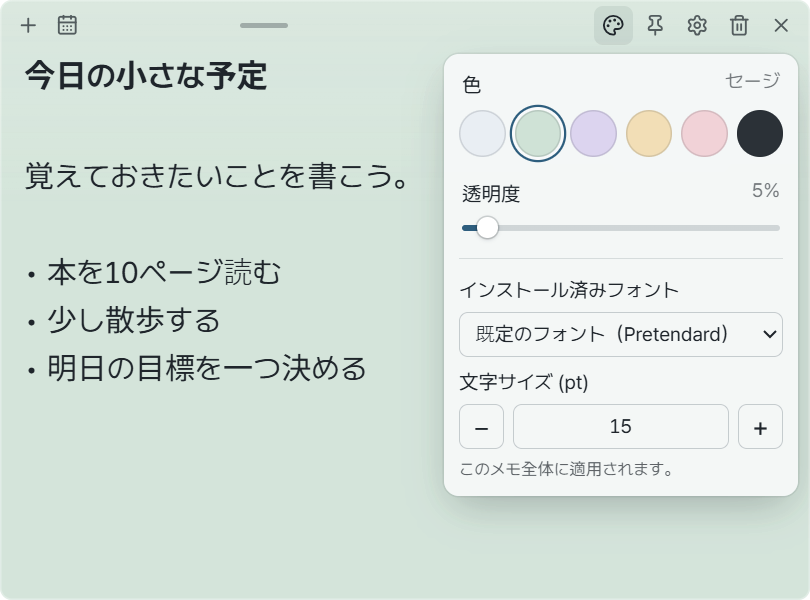
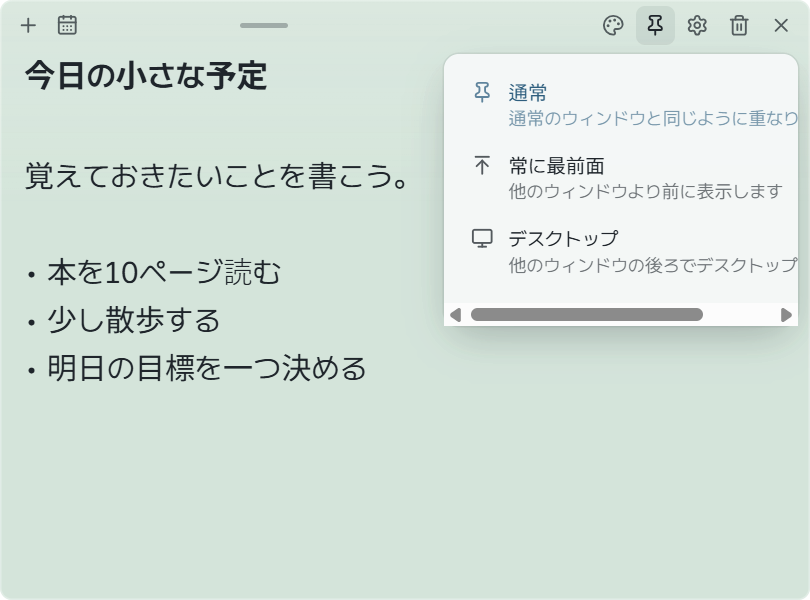
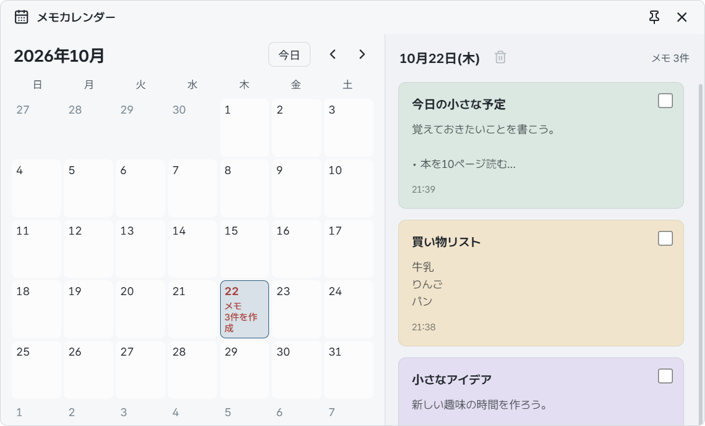
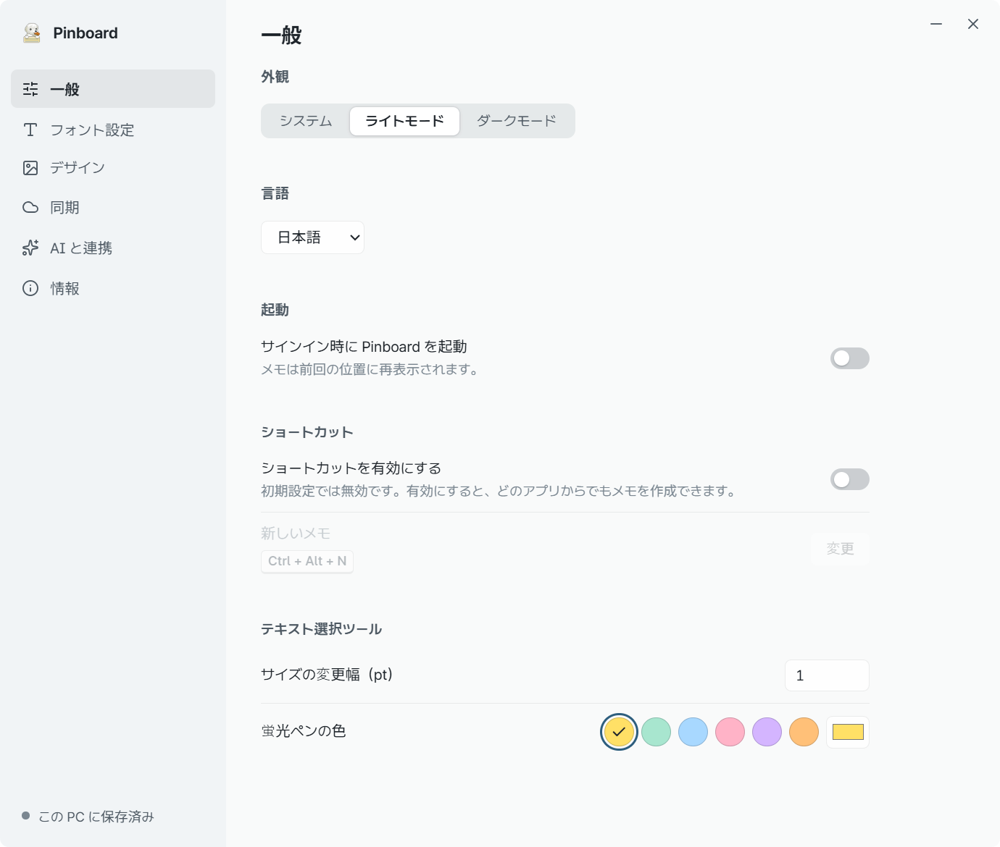
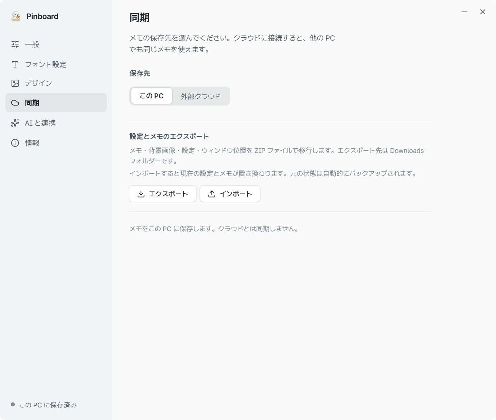

# Pinboard 使い方ガイド

[한국어](user-guide.md) | [English](user-guide.en.md) | [简体中文](user-guide.zh.md) | **日本語** | [Français](user-guide.fr.md) | [Español](user-guide.es.md)

[紹介へ戻る](../README.ja.md)

まずはメモを書いてみましょう。色や設定は、必要になったときに変えられます。
このガイドは Windows 11 向けの v0.1.0 を対象としています。画像のメモはすべて架空の例です。
画像の文字が小さいときは、クリックして原寸で表示できます。

[インストール](#install) · [メモを書く](#notes) · [見た目](#appearance) · [表示位置](#pin) · [非表示・削除](#hide-delete) · [カレンダー](#calendar) · [設定](#settings) · [バックアップ](#backup)

## 1. インストールして開く

1. [Windows インストーラー](https://github.com/CookiePiano/Pinboard/releases/download/v0.1.0/Pinboard_0.1.0_x64-setup.exe) をダウンロードします。**Windows 11 x64** が必要です。
2. インストーラーを実行し、画面の案内に従います。
3. Windows のスタートメニューから **Pinboard** を開き、表示されたメモに入力します。

アカウントや AI への接続は不要です。初期設定では、この PC にメモが保存されます。
初回の表示言語は韓国語です。メモの歯車をクリックし、**일반 → 언어 (Language Setting) → 日本語** を選んでください。以下の画像は日本語の画面です。

**インストールせずに使う場合：** [ポータブル版 ZIP](https://github.com/CookiePiano/Pinboard/releases/download/v0.1.0/Pinboard_0.1.0_windows-x64-portable.zip) をダウンロードして展開し、`Pinboard.exe` を実行します。ZIP の中から直接実行しないでください。
ポータブル版も、実行ファイルの隣ではなく PC のアプリデータフォルダーにメモを保存します。別の PC へ移すときは [バックアップとエクスポート](#backup) を使います。

### Windows に発行元の警告が表示されたら

初回リリースの 0.1.0 は署名されていないため、発行元不明の警告が表示される場合があります。
[公式リリースページ](https://github.com/CookiePiano/Pinboard/releases/tag/v0.1.0) から入手したファイルであることと、上のリンクとファイル名が一致することを確認してください。
この確認だけで安全性が保証されるわけではありません。入手元が不明なファイルは実行しないでください。
Windows のセキュリティ保護は有効にしておきます。詳しい確認方法は [ファイル検証ガイド（英語）](download-verification.md) を参照してください。

## 2. 新しいメモを書く

1. メモ上部の **＋ — 新しいメモ** ボタンをクリックします。
2. メモの中をクリックして入力します。1 行目はタイトルとして表示されます。
3. 変更は自動で保存されます。保存ボタンを押す必要はありません。

上部バー中央のハンドルをドラッグすると移動でき、端をドラッグするとサイズを変えられます。
保存エラーが出たら、メモを開いたまま、保存先の空き容量やフォルダーへのアクセスを確認してください。

## 3. 色や文字を変える

1. メモ上部の **パレット — 色と透明度** ボタンをクリックします。
2. 色を選び、**透明度** を調整します。
3. 下にある **インストール済みフォント** と **文字サイズ (pt)** を選びます。このメモだけに適用されます。

一部の文字だけを強調するには、ドラッグして選択します。**B / I / − / + / H** で太字、斜体、サイズ、ハイライトを変えられます。
背景画像を追加するには **歯車 → デザイン** を開きます。

## 4. メモの表示位置を選ぶ

上部の **ピン — 表示位置** ボタンをクリックし、モードを選びます。

| モード | 使い方 |
| --- | --- |
| **通常** | ほかのアプリと同じようにウィンドウを使う |
| **常に最前面** | ほかのアプリで作業している間もメモを表示する |
| **デスクトップ** | ほかのウィンドウの後ろ、デスクトップ上に置く |

選んだモードに合わせてアイコンが変わります。変更するときも同じボタンを使います。

## 5. 非表示にする・削除する

- **一時的に隠す：** メモの **× — 非表示** をクリックします。内容は残ります。
- **もう一度表示する：** **タスクバーの通知領域にある Pinboard アイコン → すべてのメモを表示** を右クリックメニューから選びます。見つからない場合は、隠れているアイコンを展開してください。
- **削除する：** **ごみ箱 — メモを削除** をクリックし、確認ボタンをもう一度押します。クラウド同期を有効にしている場合、ほかの PC にも削除が反映されます。
- **アプリを終了する：** 同じ通知領域のメニューから **Pinboard を終了** を選びます。

すべてのメモを隠しても、Pinboard は通知領域で動作し続けます。

## 6. カレンダーからメモを探す

1. メモ上部の **カレンダー — メモカレンダー** ボタンをクリックします。
2. メモを作成した日を選びます。メモがある日には件数が表示されます。
3. 右側の一覧でメモのカードをクリックすると、そのメモが開きます。

カレンダーは **作成日** でメモを探す機能です。リマインダーや期限の設定はできません。

## 7. 言語と起動の設定

メモから **歯車 → 一般** を開きます。

- **言語：** 日本語などの対応言語を選びます。画面の表示だけが変わり、書いたメモは翻訳されません。
- **外観：** システム、ライトモード、ダークモードから選びます。
- **サインイン時に Pinboard を起動：** Windows へのサインインと一緒に起動したい場合に有効にします。
- **ショートカットを有効にする：** 有効にして **変更** をクリックし、好きなキーの組み合わせを押すと、ほかのアプリからメモを作れます。Ctrl、Alt、Windows のいずれかを含めてください。

自動起動とグローバルショートカットは初期状態では無効です。ほかのアプリが使っている組み合わせは設定できない場合があります。

> **v0.1.0 の既知の問題：** 設定ウィンドウの X ボタンでは閉じられません。当面は最小化するか、通知領域から **Pinboard を終了** して開き直してください。ソースコードの修正によって、既存の v0.1.0 インストーラーが自動更新されるわけではありません。

## 8. バックアップする・別の PC へ移す

**バックアップを作る**

1. メモから **歯車 → 同期** を開きます。
2. **設定とメモのエクスポート** にある **エクスポート** をクリックします。
3. ダウンロードフォルダーに作成された `Pinboard_date_time.zip` を安全な場所に保管します。

**メモを復元する**

1. 移行先の PC で Pinboard を開き、**歯車 → 同期** に進みます。
2. **インポート** をクリックして、以前エクスポートした ZIP を選びます。

**インポートすると、現在のメモと設定が置き換わります。** 元の状態は先に自動でバックアップされますが、大切な内容は自分でもエクスポートしておきましょう。
バックアップにはメモ、背景画像、文字の書式、設定、ウィンドウ位置が含まれます。個人情報を含む可能性があるため、ZIP を公開の問題報告に添付しないでください。

## 必要なときだけ使う機能

- **ほかの PC と同期する：** Google Drive for Desktop が管理するフォルダーを接続します。[接続ガイド（英語）](google-drive-setup.md)
- **AI と連携する：** 自分で AI アプリを接続してアクセスを許可すると、AI がメモを読み取り、変更、削除できます。[接続ガイド（英語）](ai-collaboration.md)

普段のメモには、どちらの機能も必要ありません。メモとバックアップは暗号化されないため、パスワードなどの機密情報を保存しないでください。

## 困ったときは

[問題を報告](https://github.com/CookiePiano/Pinboard/issues) するときは、アプリのバージョンと再現手順を記載してください。
画像を添付する前に、個人的なメモ、氏名、メールアドレス、アカウント情報、フォルダーのパスが写っていないか確認してください。
セキュリティの問題は [セキュリティポリシー（英語）](../SECURITY.md) の案内に従って非公開で報告してください。

[紹介へ戻る](../README.ja.md)
