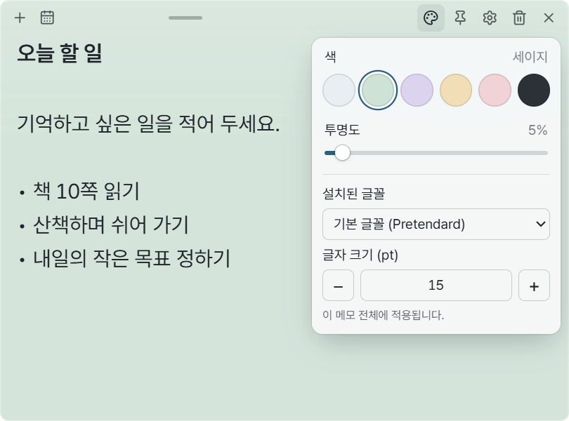
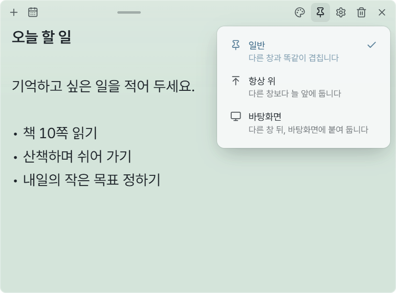
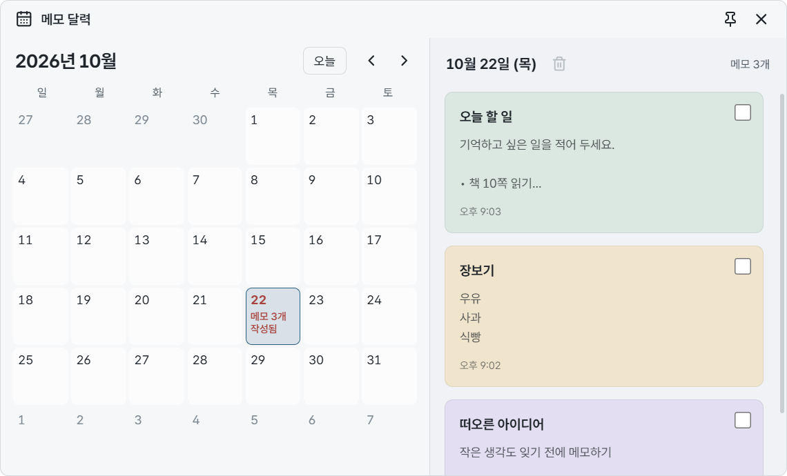
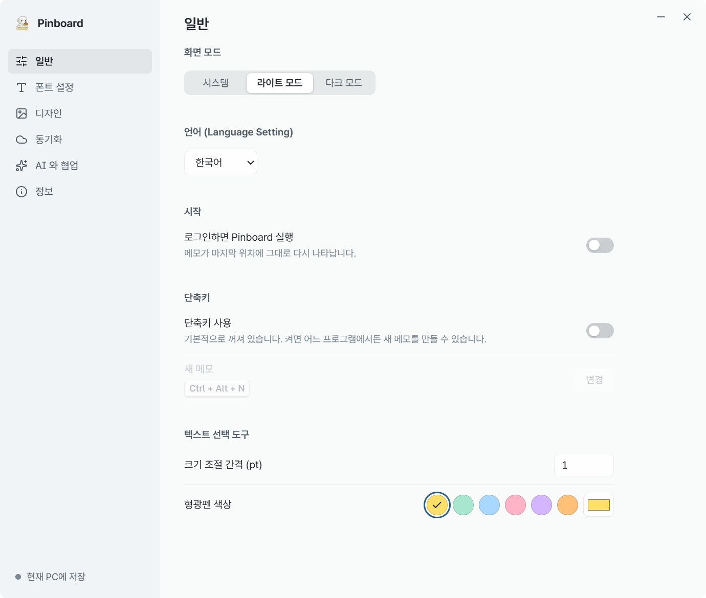
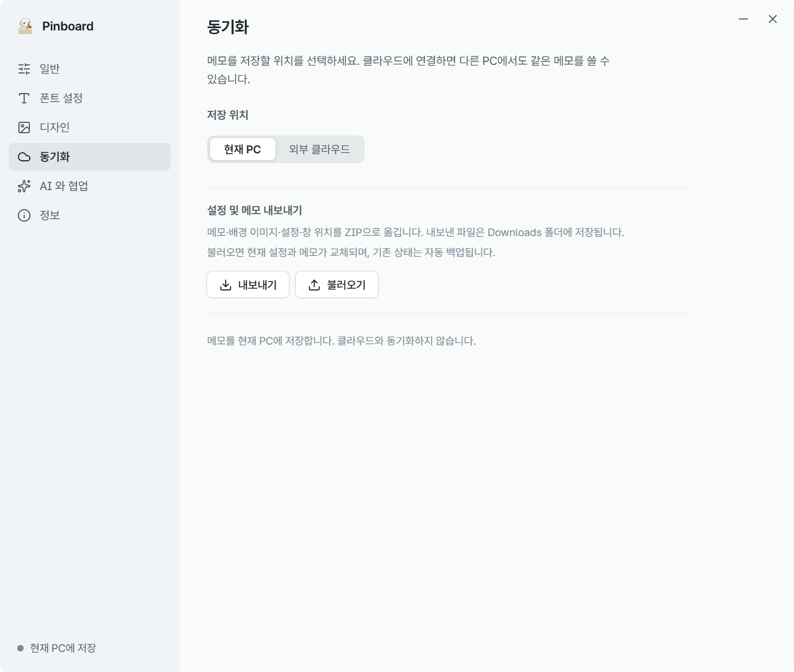

# Pinboard 사용 가이드

**한국어** | [English](user-guide.en.md) | [简体中文](user-guide.zh.md) | [日本語](user-guide.ja.md) | [Français](user-guide.fr.md) | [Español](user-guide.es.md)

[처음으로](../README.md)

처음에는 메모에 글을 적는 것만으로 충분합니다. 색상이나 설정은 필요할 때 바꿔 보세요.
이 가이드는 Windows 11용 v0.1.0을 기준으로 합니다. 모든 화면에는 설명용 예시 메모만 사용했습니다.
화면의 글자가 작게 보이면 이미지를 눌러 크게 확인하세요.

[설치](#install) · [메모 쓰기](#notes) · [꾸미기](#appearance) · [고정](#pin) · [숨기기·삭제](#hide-delete) · [달력](#calendar) · [설정](#settings) · [백업](#backup)

## 1. 설치하고 실행하기

1. [Windows용 설치 파일](https://github.com/CookiePiano/Pinboard/releases/download/v0.1.0/Pinboard_0.1.0_x64-setup.exe)을 받습니다. 지원 환경은 **Windows 11 x64**입니다.
2. 설치 파일을 실행하고 화면 안내에 따라 설치합니다.
3. Windows 시작 메뉴에서 **Pinboard**를 실행합니다. 열린 메모에 바로 글을 적어 보세요.

회원가입이나 AI 연결은 필요하지 않습니다. 기본 상태에서는 메모가 현재 PC에 저장됩니다.

**설치 없이 사용하려면:** [포터블 ZIP](https://github.com/CookiePiano/Pinboard/releases/download/v0.1.0/Pinboard_0.1.0_windows-x64-portable.zip)을 받은 뒤 압축을 풀고 `Pinboard.exe`를 실행하세요. 압축 파일 안에서 바로 실행하지 마세요.
포터블 버전도 메모를 실행 파일 옆이 아닌 PC의 앱 데이터 폴더에 저장합니다. 다른 PC로 옮길 때는 [백업](#backup)을 이용하세요.

### Windows에 게시자 경고가 나오면

첫 버전 0.1.0에는 코드 서명이 없어 게시자 확인 경고가 나올 수 있습니다.
파일을 받은 곳이 [공식 릴리스 페이지](https://github.com/CookiePiano/Pinboard/releases/tag/v0.1.0)인지, 파일명이 위 링크와 같은지 확인하세요.
이 확인만으로 파일의 안전성이 보장되지는 않습니다. 출처가 불확실하면 실행하지 마세요.
Windows 보안 기능을 끄지 말고, 필요한 경우 [파일 검증 안내 · English](download-verification.md)를 확인하세요.

## 2. 메모 만들고 쓰기

1. 메모 위쪽의 **＋ — 새 메모**를 누릅니다.
2. 메모 안을 클릭하고 내용을 적습니다. 첫 줄은 제목처럼 표시됩니다.
3. 글을 쓰면 자동으로 저장됩니다. 따로 저장 버튼을 누를 필요가 없습니다.

메모를 옮기려면 위쪽 가운데의 손잡이 부분을 드래그하세요. 가장자리를 드래그하면 크기를 바꿀 수 있습니다.
저장 오류가 표시되면 메모를 그대로 두고 저장 공간이나 폴더 접근 문제를 먼저 해결하세요.

## 3. 색상과 글자 바꾸기

1. 메모 위쪽의 **팔레트 — 색과 투명도**를 누릅니다.
2. 원하는 색을 선택하고 **투명도**를 조절합니다.
3. 아래의 **설치된 글꼴**과 **글자 크기 (pt)** 항목에서 글자를 바꿉니다. 이 설정은 현재 메모에 적용됩니다.

일부 글자만 강조하려면 글자를 드래그해 선택하세요. 나타나는 **B / I / − / + / H** 도구로 굵게, 기울임, 크기, 형광펜을 적용할 수 있습니다.
배경 이미지는 **톱니바퀴 → 디자인**에서 지정할 수 있습니다.

## 4. 메모를 원하는 위치에 고정하기

메모 위쪽의 **핀 — 위치**를 누른 뒤 원하는 방식을 선택하세요.

| 선택 | 이런 때 사용하세요 |
| --- | --- |
| **일반** | 다른 앱 창처럼 자유롭게 사용하고 싶을 때 |
| **항상 위** | 다른 앱을 사용하면서도 메모를 계속 보고 싶을 때 |
| **바탕화면** | 다른 창 뒤, 바탕화면에 메모를 붙여 두고 싶을 때 |

고정 방식을 바꾸면 위쪽 아이콘도 바뀝니다. 모양이 달라져도 같은 위치의 버튼에서 다시 선택할 수 있습니다.

## 5. 숨기기와 삭제 구분하기

- **잠깐 숨기기:** 메모의 **× — 숨기기**를 누릅니다. 메모 내용은 남아 있습니다.
- **다시 보기:** 작업 표시줄 오른쪽 알림 영역의 **Pinboard 아이콘을 오른쪽 클릭 → 모든 메모 보이기**를 선택합니다. 아이콘이 안 보이면 숨겨진 아이콘을 펼쳐 보세요.
- **삭제하기:** 메모의 **휴지통 — 메모 삭제**를 누르고, 나타나는 확인 버튼을 한 번 더 누릅니다. 숨기기와 달리 메모를 삭제하는 동작입니다. 클라우드 동기화를 사용 중이면 다른 PC에도 삭제가 반영됩니다.
- **앱 끝내기:** 같은 알림 영역 메뉴에서 **Pinboard 종료**를 선택합니다.

메모를 모두 숨겨도 Pinboard는 알림 영역에서 계속 실행됩니다.

## 6. 달력에서 메모 찾기

1. 메모 위쪽의 **달력 — 메모 달력**을 누릅니다.
2. 메모를 작성한 날짜를 선택합니다. 메모가 있는 날짜에는 개수가 표시됩니다.
3. 오른쪽 목록에서 원하는 메모 카드를 클릭하면 해당 메모가 열립니다.

달력은 메모를 **작성한 날짜**로 찾아보는 기능입니다. 일정 알림이나 마감일을 설정하는 기능은 아닙니다.

## 7. 언어와 시작 설정 바꾸기

메모의 **톱니바퀴 → 일반**을 엽니다.

- **언어 (Language Setting):** 한국어, English 등 원하는 언어를 선택하세요. 화면만 바뀌며 직접 쓴 메모는 번역되지 않습니다.
- **화면 모드:** 시스템, 라이트 모드, 다크 모드 중에서 선택하세요.
- **로그인하면 Pinboard 실행:** PC에 로그인할 때 함께 실행하고 싶으면 켜세요.
- **단축키 사용:** 켠 뒤 **변경**을 누르고 원하는 키 조합을 입력하면 다른 앱에서도 새 메모를 만들 수 있습니다. Ctrl, Alt 또는 Windows 키를 포함한 조합을 사용하세요.

자동 실행과 전역 단축키는 처음에는 꺼져 있습니다. 다른 앱이 이미 사용하는 키 조합은 등록되지 않을 수 있습니다.

> **v0.1.0의 알려진 문제:** 설정 창의 X 버튼이 작동하지 않습니다. 임시로 최소화 버튼을 사용하거나, 알림 영역에서 **Pinboard 종료** 후 다시 실행하세요. 수정 코드는 저장소에 반영되지만 기존 v0.1.0 설치 파일은 자동으로 변경되지 않습니다.

## 8. 메모 백업하고 옮기기

**백업할 때**

1. 메모의 **톱니바퀴 → 동기화**를 엽니다.
2. **설정 및 메모 내보내기 → 내보내기**를 누릅니다.
3. 다운로드 폴더에 생성된 `Pinboard_날짜_시간.zip` 파일을 안전한 곳에 보관합니다.

**다시 불러올 때**

1. 사용할 PC에서 Pinboard를 실행하고 **톱니바퀴 → 동기화**를 엽니다.
2. **불러오기**를 누르고 이전에 내보낸 ZIP 파일을 선택합니다.

**불러오면 현재 메모와 설정이 교체됩니다.** 기존 상태는 먼저 자동 백업되지만, 중요한 내용은 직접 내보내 두는 것이 좋습니다.
백업에는 메모, 배경 이미지, 서식, 설정, 창 위치가 포함됩니다. ZIP에는 개인 메모가 들어갈 수 있으므로 공개 게시글에 첨부하지 마세요.

## 필요할 때만 켜는 기능

- **다른 PC와 동기화:** 데스크톱용 Google Drive가 관리하는 폴더를 연결할 수 있습니다. [연결 방법 · English](google-drive-setup.md)
- **AI와 협업:** 원하는 AI 앱과 직접 연결하고 허용해야 사용할 수 있습니다. 연결한 AI는 메모를 읽거나 변경·삭제할 수 있습니다. [연결 방법 · English](ai-collaboration.md)

기본 메모 사용에는 두 기능 모두 필요하지 않습니다. 메모와 백업 파일은 암호화되지 않으므로 비밀번호 같은 민감한 정보는 보관하지 마세요.

## 도움이 필요하면

[문제 알리기](https://github.com/CookiePiano/Pinboard/issues)에 앱 버전과 문제가 생기는 순서를 적어 주세요.
화면을 첨부할 때는 메모 내용, 이름, 이메일, 계정 정보, 폴더 경로가 보이지 않는지 먼저 확인하세요.
보안 문제는 공개 게시글 대신 [보안 정책의 신고 방법 · English](../SECURITY.md)을 이용하세요.

[처음으로](../README.md) · [English guide](user-guide.en.md)
