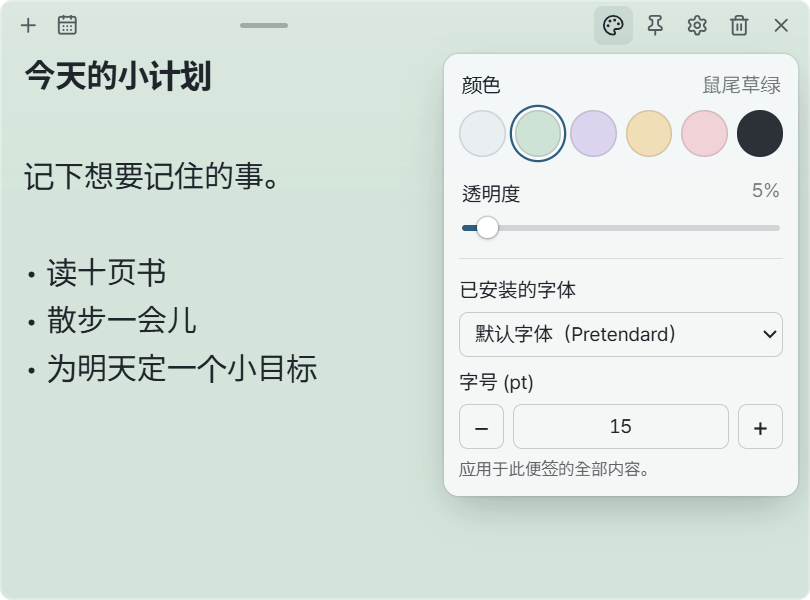
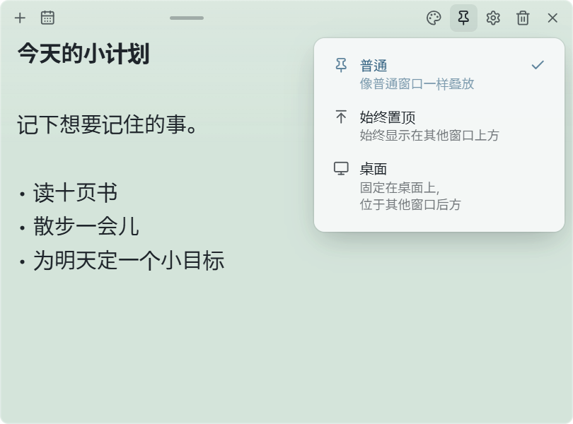
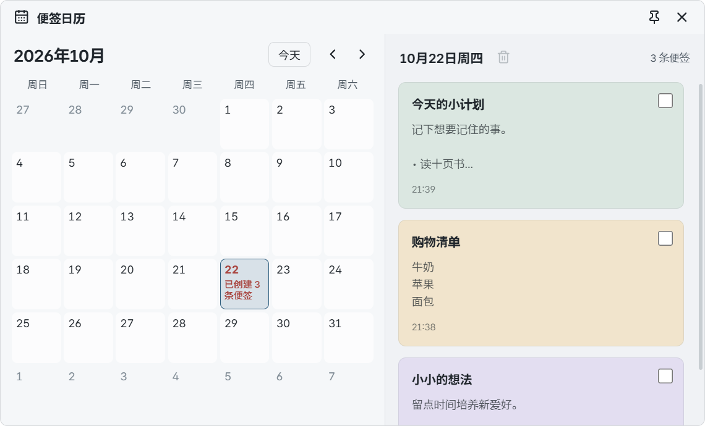
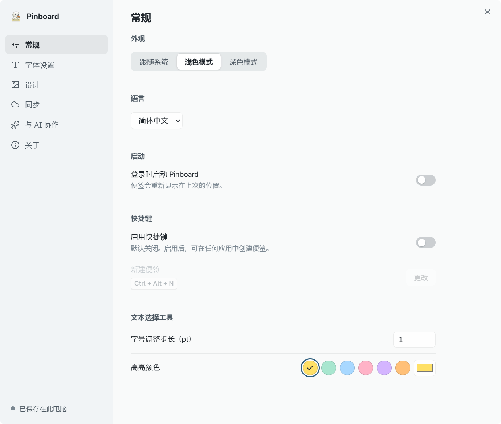
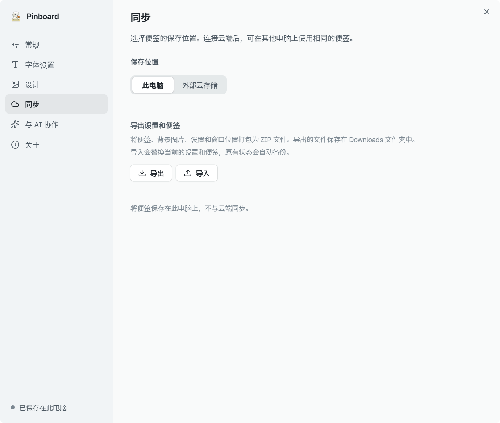

# Pinboard 使用指南

[한국어](user-guide.md) | [English](user-guide.en.md) | **简体中文** | [日本語](user-guide.ja.md) | [Français](user-guide.fr.md) | [Español](user-guide.es.md)

[返回简介](../README.zh.md)

先写下一条便签，需要时再调整颜色和设置。
本指南适用于 Windows 11 上的 v0.1.0。截图中的便签都是虚构示例。
如果截图中的文字太小，可以点击图片查看原图。

[安装](#install) · [写便签](#notes) · [调整外观](#appearance) · [固定位置](#pin) · [隐藏或删除](#hide-delete) · [日历](#calendar) · [设置](#settings) · [备份](#backup)

## 1. 安装并打开 Pinboard

1. 下载 [Windows 安装程序](https://github.com/CookiePiano/Pinboard/releases/download/v0.1.0-r2/Pinboard_0.1.0_x64-setup.exe)。需要 **Windows 11 x64**。
2. 运行安装程序，按照提示完成安装。
3. 从 Windows 开始菜单打开 **Pinboard**，在出现的便签中输入文字。

不需要账号，也不需要连接 AI。默认情况下，便签保存在这台电脑上。
首次启动时界面为韩语。点击便签上的齿轮，再选择 **일반 → 언어 (Language Setting) → 简体中文**。下方截图使用简体中文界面。

**不想安装？** 下载 [便携版 ZIP](https://github.com/CookiePiano/Pinboard/releases/download/v0.1.0-r2/Pinboard_0.1.0_windows-x64-portable.zip)，解压后运行 `Pinboard.exe`。不要直接从 ZIP 内运行。
便携版也会将便签保存在本机的应用数据文件夹中，而不是程序旁边。换电脑时，请使用 [备份和导出](#backup)。

### 如果 Windows 提示发布者未知

首个版本 0.1.0 尚未签名，因此 Windows 可能显示发布者未知的提示。
请确认文件来自 [官方发布页面](https://github.com/CookiePiano/Pinboard/releases/tag/v0.1.0-r2)，且文件名与上面的链接一致。
仅凭这些检查不能保证文件安全。如果无法确认来源，请勿运行。
请保持 Windows 安全防护开启。更多检查方法见 [文件验证指南（英文）](download-verification.md)。

## 2. 新建便签并开始写

1. 点击便签顶部的 **＋ — 新建便签** 按钮。
2. 点击便签内部并输入文字。第一行会显示为标题。
3. 修改会自动保存，无需点击保存按钮。

拖动顶部栏中间的手柄可以移动便签，拖动边缘可以调整大小。
如果出现保存错误，请保持便签打开，先解决存储空间或文件夹访问问题。

## 3. 调整颜色和文字

1. 点击便签顶部的 **调色板 — 颜色与透明度** 按钮。
2. 选择颜色，再调整 **透明度**。
3. 在下方选择 **已安装的字体** 和 **字号 (pt)**。这些设置只应用于当前便签。

要突出几个字，可以拖动选中文字，再使用 **B / I / − / + / H** 调整粗体、斜体、大小和高亮。
要添加背景图片，请打开 **齿轮 → 设计**。

## 4. 选择便签显示的位置

点击顶部的 **图钉 — 位置** 按钮，然后选择一种模式。

| 模式 | 用途 |
| --- | --- |
| **普通** | 像其他应用窗口一样使用 |
| **始终置顶** | 在其他应用中工作时仍能看到便签 |
| **桌面** | 将便签留在桌面上，位于其他窗口后面 |

按钮图标会随模式改变。再次点击同一个按钮即可更改。

## 5. 隐藏或删除便签

- **暂时隐藏：** 点击便签上的 **× — 隐藏**，内容会保留。
- **重新显示：** 右键点击 **任务栏通知区域中的 Pinboard 图标 → 显示所有便签**。找不到图标时，先展开隐藏的图标。
- **删除：** 点击 **垃圾桶 — 删除便签**，再点击一次确认按钮。便签会被删除；如果开启了云同步，删除也会同步到其他电脑。
- **退出应用：** 在同一个通知区域菜单中选择 **退出 Pinboard**。

即使所有便签都被隐藏，Pinboard 仍会在通知区域运行。

## 6. 用日历找到便签

1. 点击便签顶部的 **日历 — 便签日历** 按钮。
2. 选择便签的创建日期。有便签的日期会显示数量。
3. 点击右侧列表中的便签卡片即可打开。

日历按 **创建日期** 查找便签，不用于设置提醒或截止日期。

## 7. 选择语言和启动选项

在便签中打开 **齿轮 → 常规**。

- **语言：** 选择简体中文或其他支持的语言。只会更改界面，不会翻译你写的文字。
- **外观：** 选择跟随系统、浅色模式或深色模式。
- **登录时启动 Pinboard：** 如果希望登录 Windows 后自动启动应用，请开启此项。
- **启用快捷键：** 开启后点击 **更改**，再按下喜欢的组合键，即可从其他应用中新建便签。组合键必须包含 Ctrl、Alt 或 Windows 键。

自动启动和全局快捷键默认关闭。如果其他应用已占用某个快捷键，该组合可能无法使用。

> **如果设置窗口无法关闭：** 请重新下载并安装修正版 **v0.1.0-r2**。应用版本仍为 0.1.0，原来的 v0.1.0 下载文件不包含此修复。

## 8. 备份或迁移便签

**创建备份**

1. 在便签中打开 **齿轮 → 同步**。
2. 在 **导出设置和便签** 下点击 **导出**。
3. 将“下载”文件夹中生成的 `Pinboard_date_time.zip` 妥善保存。

**恢复便签**

1. 在目标电脑上打开 Pinboard，进入 **齿轮 → 同步**。
2. 点击 **导入**，选择之前导出的 ZIP。

**导入会替换当前便签和设置。** 应用会先自动备份原有状态，但建议你自行导出重要内容。
备份包含便签、背景图片、文字格式、设置和窗口位置。ZIP 可能包含私人便签，请勿上传到公开的问题报告中。

## 可选功能

- **与其他电脑同步：** 连接由 Google Drive for Desktop 管理的文件夹。[连接指南（英文）](google-drive-setup.md)
- **与 AI 协作：** 主动连接 AI 应用并允许访问后，AI 可以读取、修改和删除便签。[连接指南（英文）](ai-collaboration.md)

日常记事不需要启用这些功能。便签和备份未加密，请勿用来保存密码等敏感信息。

## 需要帮助？

[报告问题](https://github.com/CookiePiano/Pinboard/issues) 时，请提供应用版本和复现步骤。
上传截图前，请确认没有私人便签、姓名、邮箱、账号信息或文件夹路径。
安全问题请按照 [安全政策（英文）](../SECURITY.md) 中的说明私下报告。

[返回简介](../README.zh.md)
